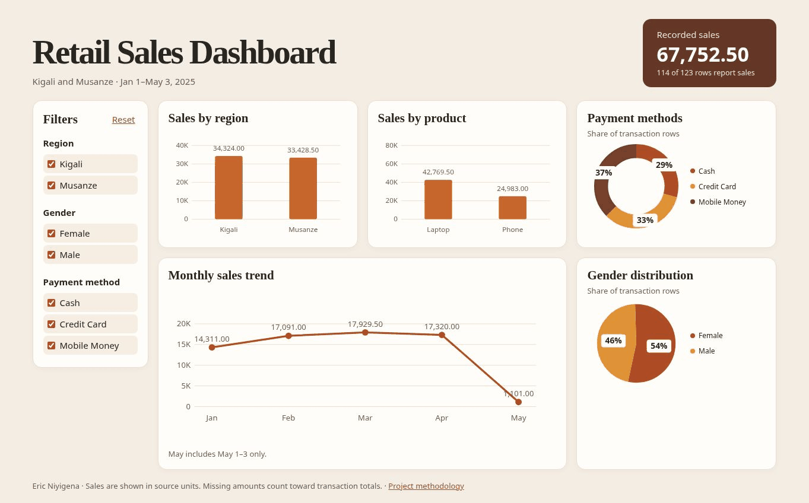

# Retail Sales Dashboard

**Eric Niyigena · Excel portfolio project**

A retail performance dashboard for Kigali and Musanze that shows when recorded sales peaked, which product type contributed most, and how customers paid. The analysis covers January 1 through May 3, 2025.

[Open the interactive dashboard](https://eniyigena.github.io/Excel-Dashboard/)

Use the Region, Gender, and Payment Method filters to explore the fixed dataset. The payment and gender charts show the share of matching transaction rows on each slice.

| Metric | Result |
| --- | ---: |
| Recorded sales (source units) | 67,752.50 |
| Transaction rows | 123 |
| Rows with reported sales amounts | 114 (92.7%) |
| Rows missing sales amounts | 9 |

## Findings

- **Laptops led recorded sales.** They accounted for 42,769.50, or 63.1% of the total. A retail manager could compare margins and stock availability before shifting purchasing toward laptops.
- **March led the four complete months.** Recorded sales reached 17,929.50. May contains three days and should be compared with the first three days of earlier months.
- **Regional sales were close.** Kigali recorded 34,324.00 across 62 rows, and Musanze recorded 33,428.50 across 61 rows.
- **Mobile money led by payment count.** It appeared on 46 of 123 rows (37.4%), ahead of credit card (41) and cash (36).

## How the analysis was built

1. Rebuilt the analysis from the original workbook's raw worksheet after detecting type errors in its cleaned sheet.
2. Parsed three date formats and standardized product, region, and payment labels.
3. Interpreted eight `12OO` values as 1,200. This assumption contributes 9,600 to recorded sales. Excluding those eight values would put the total at 58,152.50. Nine blank amounts were left missing.
4. Kept both rows sharing a transaction ID because their transaction details differ. Counts use source rows as the unit of observation.
5. Reconciled recorded sales across month, product, region, and payment method.

## Scope

The source workbook supplies no currency or provenance information. This preview contains aggregate results. Recorded sales are the sum of reported amounts after the documented correction. Payment counts include rows with missing amounts. Product comparisons use product types, and the data does not include unit costs or margins.
